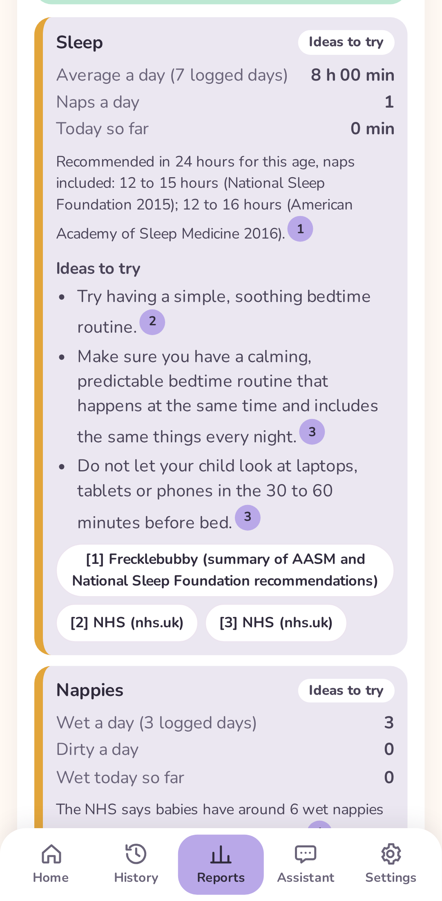
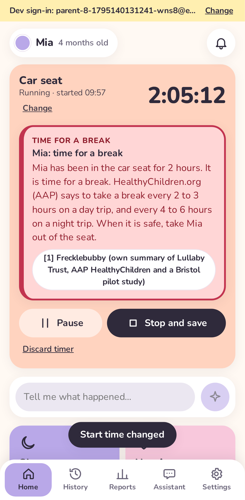

# Frecklebubby

A baby tracker that you host yourself.

Version 0.2.0. See [CHANGELOG.md](CHANGELOG.md).

## What it does

- Tracks sleep, nursing, bottles, solids, nappies, potty, pumping, growth, temperature, medicine, activities,
  play with tummy time, time in a car seat or other seat, crying, milestones and notes.
- Supports more than one child and more than one carer. Carers join by invite.
- Has live timers for sleep, nursing, pumping, activities, play (with a tummy-time part) and confined time. A timer
  keeps running when you close the app.
- Tells you when a child has been in a car seat, bouncer, swing, pram, carrier or high chair for a long time: a
  note at 1 hour (children under 5 years) and a break warning at 2 hours (children under 12 months), with sources.
- Records nappy details: rash, time with the nappy off, poo colour and texture, pee colour, look and smell.
- Shows reports: sleep, feeds and nappies per day, and growth on WHO percentile curves. Exports CSV.
- Sends reminders in the app and as push notifications.
- Has a REST API and an MCP server, so scripts and AI assistants such as Claude can read and write the data.
- Has an AI assistant that runs on an open model on your own server. It logs from plain words
  ("120 ml formula 20 minutes ago") on the Home screen and in the chat, answers questions with citations to
  medical sources, makes a sleep plan, and shows insights.
- Gives development guidance from birth to 5 years: what most children do by each age (CDC), movement, behaviour
  and body changes to expect around now, cited tips on how to help, and a notification at each new age band.
  For a baby born early, give the due date and the app uses the corrected age until 2 years.
- Makes a support report: the last 7 days by area, compared with cited references, with suggestions on where you
  can support your child.
- Copies your data out of the Huckleberry app, once or as often as you like.

| Home with timers | Log by plain words | Assistant with sources | Assistant logs for you | Development guidance |
|---|---|---|---|---|
|  |  |  |  |  |

| Sleep plan | Reports | Support report | Cry helper | Confined-time warning |
|---|---|---|---|---|
|  |  |  |  |  |

## Not medical advice

Frecklebubby gives general information only. It is not a medical device. If you are worried about your child, speak
to a doctor or nurse. In an emergency, call your local emergency number.

## Contents

- [Quick start](#quick-start)
- [Clerk sign-in](#clerk-sign-in)
- [HTTPS](#https)
- [Install on a phone](#install-on-a-phone)
- [Connect Claude (MCP)](#connect-claude-mcp)
- [REST API](#rest-api)
- [The AI model](#the-ai-model)
- [Sleep model](#sleep-model)
- [Cry helper](#cry-helper)
- [Knowledge library and licences](#knowledge-library-and-licences)
- [Move from Huckleberry](#move-from-huckleberry)
- [Backup](#backup)
- [Development](#development)
- [Troubleshooting](#troubleshooting)
- [Licence](#licence)

## Quick start

You need Docker with Compose, or Podman with `podman compose`. You need about 6 GB of disk for the model and
8 GB of memory.

1. Get the code:

   ```bash
   git clone https://github.com/dr-robert-li/frecklebubby
   cd frecklebubby
   ```

2. Copy the settings file and fill it in. Read the comments in the file.

   ```bash
   cp .env.example .env
   ```

   For normal use you need the Clerk values (see [Clerk sign-in](#clerk-sign-in)) and `BASE_URL`.

3. Start:

   ```bash
   docker compose up -d        # or: podman compose up -d
   ```

   This builds the app and starts two containers: `app` (Frecklebubby) and `llama` (the AI model server).
   On the first start the model server downloads the model (about 5 GB). This can take a long time.
   The app works while the download runs. Only the assistant says "The assistant is not available now".

4. Open `http://<your server>:8000` (or your `BASE_URL`). Sign in, make your family and add your child.

To see the logs: `docker compose logs -f app` or `docker compose logs -f llama`.
To stop: `docker compose down`. Your data stays in the volume `data`.

### Try it on your own computer without Clerk

Put `AUTH_MODE=dev` in `.env`. Then there is no sign-in. **Anyone who can reach the server can act as any user.**
Use this only on your own computer, never on a server that other people can reach.

## Clerk sign-in

Frecklebubby uses [Clerk](https://clerk.com) for sign-in with Google or GitHub. Clerk is also the OAuth provider for
Claude connectors. A free Clerk development instance is enough for a family.

In the Clerk dashboard:

1. Make an application. Turn on **Google** and **GitHub** under **SSO connections > Add connection > For all
   users**. Development instances need no Google or GitHub setup.
2. **User authentication > Access mode**: select **Invite-only**. Invite each family member under **Users**.
   (Also invite them in Frecklebubby: **Settings > Family > Invite**.)
3. **Sessions > Customize session token**: add the email claim. Frecklebubby needs it to know who signed in:

   ```json
   {
     "email": "{{user.primary_email_address}}",
     "name": "{{user.full_name}}"
   }
   ```

4. **OAuth applications > Add application** (for Claude and other MCP clients): scopes `openid email profile`,
   redirect URI `<BASE_URL>/auth/callback`, entered exactly, with no `/` at the end. Copy the client ID and the
   client secret. Clerk shows the secret only once.
5. Copy these values to `.env`:

   | `.env` | Where in Clerk |
   |---|---|
   | `CLERK_PUBLISHABLE_KEY` | **API keys > Publishable key** (`pk_...`) |
   | `CLERK_DOMAIN` | The instance host, for example `your-instance.clerk.accounts.dev` (no `https://`) |
   | `CLERK_OAUTH_CLIENT_ID`, `CLERK_OAUTH_CLIENT_SECRET` | The OAuth application from step 4 |

Optional: put a comma list of emails in `ALLOWED_EMAILS`. Then other emails cannot sign in, even with an invite.

The server does not start in Clerk mode if a value is missing. The log names the missing value.

> Not yet tested with a real Clerk account. The sign-in code is tested with test tokens only.

## HTTPS

You need HTTPS for:

- push notifications (browsers allow them only on HTTPS),
- Claude connectors (Claude connects only to HTTPS servers),
- install on a phone as an app.

Two ways:

**Tailscale Funnel** gives you a public HTTPS address with no domain and no open port:

```bash
tailscale funnel --bg 8000      # https://<machine>.<tailnet>.ts.net -> 127.0.0.1:8000
```

Funnel must be on for your tailnet. The first `tailscale funnel` run prints a link to turn it on. Put the
`https://<machine>.<tailnet>.ts.net` address in `BASE_URL` and restart: `docker compose up -d`.

**A reverse proxy** (Caddy, nginx, Traefik) with your own domain also works. Send all paths to port 8000. Do not
buffer responses: the assistant streams its answers (Server-Sent Events). Set `BASE_URL` to the public address.

## Install on a phone

1. Open your `BASE_URL` in the phone browser and sign in.
2. iPhone (Safari): **Share > Add to Home Screen**. Android (Chrome): **menu > Install app** (or **Add to Home
   screen**).
3. Open Frecklebubby from the Home Screen. Go to **Settings > Notifications** and select
   **Turn on notifications**. On iPhone, push works only in the app that you added to the Home Screen.

> Push on a real phone is not yet tested. The tests prove the reminder and the in-app notification, and the
> server's push sending code. See [Development](#development).

## Connect Claude (MCP)

Frecklebubby has an MCP server at `<BASE_URL>/mcp`. Claude can then log entries, start timers, read reports and
search the knowledge library for you.

You can say it in plain words ("she had 120 ml at 2 and I put her in the car seat"): Claude uses one tool per kind
of entry, or the `log_in_plain_words` tool, and the entry is saved, not only read.

1. On claude.ai, open **Settings > Connectors > Add custom connector**.
2. Enter `<BASE_URL>/mcp` and add it.
3. Select **Connect** and sign in with Google or GitHub (the same account as in Frecklebubby).

The connector then also shows in the Claude mobile app for the same account. Each family member does these steps
in their own Claude account.

**Local MCP clients** (for example Claude Desktop or Claude Code on the same computer) can use stdio. No sign-in
applies; the tools act as one user:

```bash
docker compose exec app frecklebubby-mcp --stdio --user you@example.com
# without containers:
uv run frecklebubby-mcp --stdio --user you@example.com
```

`--user` can be left out when the database has only one user.

> The Claude connector is not yet tested with a real Clerk account.

## REST API

All functions of the app are in the REST API at `<BASE_URL>/api/v1`. The API reference (OpenAPI) is at
`<BASE_URL>/api/docs`, and the machine-readable file at `<BASE_URL>/api/openapi.json`.

For scripts, make a personal access token in **Settings > API tokens**. The app shows the token only once.

```bash
TOKEN=fb_pat_...
# list children
curl -H "Authorization: Bearer $TOKEN" https://frecklebubby.example.com/api/v1/children
# log a 120 ml formula bottle now for child 1
curl -H "Authorization: Bearer $TOKEN" -H "Content-Type: application/json" \
  -d "{\"type\":\"bottle\",\"started_at\":\"$(date -u +%Y-%m-%dT%H:%M:%SZ)\",\"data\":{\"amount_ml\":120,\"milk_type\":\"Formula\"}}" \
  https://frecklebubby.example.com/api/v1/children/1/entries
```

A time without an offset is read in the family time zone. Errors come back as `{"detail": "plain message"}`.

## The AI model

The `llama` container runs [llama.cpp](https://github.com/ggml-org/llama.cpp) with one fixed model:
**Gemma 4 E4B** (`unsloth/gemma-4-E4B-it-GGUF`, Q4_K_M, about 5 GB), licence Apache-2.0. It runs on the CPU. No GPU
is necessary.

Speed measured on a 16-thread CPU with no GPU (about 29 tokens, or word parts, per second):

| Task | Time |
|---|---|
| Log from plain words | 2 to 5 s |
| Assistant answer | 4 to 10 s |
| Sleep plan | about 1 minute |

A slower computer takes longer. When the model is not available, all trackers still work. Only the AI functions
say "The assistant is not available now".

**Use another model server.** Any server with an OpenAI-compatible `/v1/chat/completions` endpoint works (for
example a llama.cpp or vLLM server with a GPU). Open **Settings > AI model**, enter the server URL (ending in
`/v1`), the model name and the key if the server needs one. Select **Save**, then **Test connection**. These
settings are per family. The defaults come from `LLM_BASE_URL`, `LLM_MODEL` and `LLM_API_KEY` in `.env`. The model
must support JSON schema output (`response_format`), as llama.cpp does.

## Sleep model

The Home screen shows the next nap or bedtime. With the bundled **sleep norms file** it uses your child's last 14 days and typical patterns of babies of the same
age, and it shows an 80 % range ("earliest" to "latest"). Insights then also show the current nap stage (for example
"Mostly 3 naps a day"), compare total sleep with babies of the same age, and show a card when a nap change is common
at this age. The recommended sleep ranges (AASM 2016, NSF 2015) stay the main reference.

- **What it is**: a JSON file with sleep percentiles by age (0 to 24 months) and the settings of the predictor. It
  has no data about single babies.
- **Where it comes from**: made with `training/sleep/` from the infant-sleep data of Liu et al. (2019),
  "Time-Series Analysis via Low-Rank Matrix Factorization Applied to Infant-Sleep Data"
  (<https://arxiv.org/abs/1904.04780>): 700 babies whose parents logged sleep in the Baby Connect app. On babies
  not used to make the file, the start of the next sleep was within 30 minutes 53 % of the time (old table 49 %);
  the median error was 27 minutes (old table 32 minutes). How to make the file: `training/sleep/README.md`.
- **Licence**: the data is open for non-commercial use with attribution to Liu et al. The norms file
  (`src/frecklebubby/data/sleep_norms.json`) and the data file (`training/sleep/data/`) have the same terms.
- **Your own file**: put `sleep_norms.json` in the data folder (`DATA_DIR/sleep_norms.json`; in the container
  `/data`, the `data` volume), or set `SLEEP_NORMS_PATH` to its full path. It replaces the bundled file. Restart is
  not necessary.
- **Fallback**: a table of common wake windows by age (`src/frecklebubby/data/wake_windows.json`). The app uses it
  when the file is missing or not valid, or the child is older than 24 months, or no night sleep is
  logged in the last 24 hours, the app uses the wake-window table as before.

## Cry helper

The **Crying?** tile on the Home screen answers "what do I check first?".

- **Just tell me what to check**: uses only the logs (last feed, last sleep, last nappy, age). It ranks the likely
  needs, gives things to try and says when to get medical help. Each fact has a source from the built-in NHS and CDC
  library. This part needs no model and no microphone.
- **Listen**: records up to 60 seconds and adds a guess from the sound. The audio is analysed on your server and is
  not stored.
- You can save the crying time and what helped to the timeline. Reports show crying per day.

**The sound guess is experimental. It is a guess, not a diagnosis.** There are two models:

- **Cry detector**: finds crying and snoring in the recording. On the test recordings of its dataset it found 40 of
  43 clips with a cry and gave no false alarm on 39 clips without one.
- **Cry reason** (hungry, tired, burping, belly pain, discomfort, scared): trained on 489 clips where the label is
  the parent's own guess, and 382 of them say "hungry". On babies the model had not heard it was right 80 % of the
  time; "always hungry" is right 78 % of the time. Thus the logs decide the order of the list, and the sound guess
  is shown only as a hint. The app reads these numbers from `model_card.json` and shows them to the parent.

The model files are bundled in `src/frecklebubby/data/models/cry/`. They are for **non-commercial use, with
attribution** (ICSD is CC BY-NC-SA 4.0; see `NOTICE.txt` in that folder). Without the files, or without the `cry`
extra, the app says "Sound analysis is not installed on this server." and the rest works.

- **Make the files again**: `training/cry/README.md`. You need the ICSD dataset and the DeepInfant clips.
- **Your own models**: put `cry_detector.onnx`, `cry_reason.onnx`, `model_card.json` and `NOTICE.txt` in
  `DATA_DIR/models/cry` (in the container `/data/models/cry`, the `data` volume), or set `CRY_MODEL_DIR`. They
  replace the bundled models.
- **Without containers**: install the extra (`uv sync --extra cry`) and the `ffmpeg` program. The container image has
  both.
- **Microphone**: browsers give the microphone only to HTTPS pages (or `localhost`). See [HTTPS](#https).

## Knowledge library and licences

The assistant answers from these sources and shows each source it used:

- **Built-in library** (`src/frecklebubby/data/library/`): pages from the NHS and the CDC.
  - NHS pages: Contains public sector information licensed under the Open Government Licence v3.0.
  - CDC pages: Material developed by CDC. Public domain; reference does not imply endorsement by CDC or the U.S.
    Government. Available free at cdc.gov.
  - CDC "Learn the Signs. Act Early." milestone checklists (public domain), with the same notice.
- **Trusted sources (links only)**: for example Raising Children Network, Red Nose, healthdirect, AAP and
  well-known sleep books. Frecklebubby stores only the title and the link, not their text.
- **WHO growth data** (`src/frecklebubby/data/growth/`): WHO Child Growth Standards, World Health Organization,
  2006. WHO allows use for non-commercial purposes with acknowledgment of WHO as the source. If you use
  Frecklebubby commercially, get written permission from WHO. WHO does not endorse Frecklebubby. See
  `src/frecklebubby/data/growth/NOTICE.md`.
- **Your uploads**: in **Settings > Knowledge sources** you can add PDF, EPUB, text or Markdown files (up to
  50 MB), for example notes from your doctor. Only your family can use them. You can delete them.
- **Web lookup** (off by default): in **Settings > AI model** you can let the assistant read pages from an approved
  list of medical websites (`src/frecklebubby/data/web_allowlist.txt`). Pages are kept for 7 days.

If a question is not covered by the sources, the assistant says so. Urgent warnings (for example a fever in a
baby under 3 months) come from fixed rules, not from the model, and always show first.

## Move from Huckleberry

**Settings > Import from Huckleberry** copies your children and their full history (sleep, feeds, nappies, potty,
pumping, growth, temperature, medicine, activities) from your Huckleberry account.

- Enter your Huckleberry email and password. The password is used only during the import. It is not stored or
  logged.
- The import runs in the background and shows its progress. You can leave the page.
- Each Huckleberry child becomes a new child in Frecklebubby, also when you already have a child with that name.
- You can run it again at any time. It does not make copies twice. A new run updates the rows that it imported
  before, so changes you made in Frecklebubby to imported rows are overwritten. Rows that you logged in
  Frecklebubby are not changed.
- Rows that are not valid (for example a time in the future or a bottle over 500 ml) are skipped. The result
  lists them.
- It is a copy, not a sync. Huckleberry is not changed.

> Tested with a built-in fake Huckleberry account. Not yet tested with a real Huckleberry account.

This project is not affiliated with Huckleberry Labs Inc.

## Backup

All data is in one SQLite database in the data folder (`/data` in the container, the volume `data`). The same folder
has the key for push notifications (`vapid_private.pem`). Keep the two together.

```bash
# copy the database out of the running container (safe while it runs)
docker compose exec app python -c "import sqlite3; sqlite3.connect('/data/frecklebubby.db').backup(sqlite3.connect('/data/backup.db'))"
docker compose cp app:/data/backup.db ./frecklebubby-backup.db
# podman compose has no "cp": use the container name from "podman ps", for example
podman cp frecklebubby_app_1:/data/backup.db ./frecklebubby-backup.db
```

To restore: stop the app, copy the file back to `/data/frecklebubby.db`, start the app. You can also copy the whole
volume with your normal volume backup tool. You can also export a CSV for each child in **Reports**.

## Development

Without containers you need Python 3.14 with [uv](https://docs.astral.sh/uv/), Node.js 22 or newer, and a
llama.cpp `llama-server` for the AI functions.

```bash
uv sync --extra import                         # Python packages (with the Huckleberry import)
(cd frontend && npm ci && npm run build)       # web app, built into src/frecklebubby/static
AUTH_MODE=dev LLM_BASE_URL=http://127.0.0.1:8082/v1 uv run frecklebubby   # http://127.0.0.1:8000

llama-server -hf unsloth/gemma-4-E4B-it-GGUF:Q4_K_M --no-mmproj --jinja --reasoning-budget 0 \
  --chat-template-kwargs '{"enable_thinking":false}' -c 8192 --host 127.0.0.1 --port 8082
```

For frontend work with hot reload: `cd frontend && BACKEND=http://127.0.0.1:8000 npm run dev`.

Tests:

```bash
uv run pytest                  # backend: services, API, isolation, timers, reminders, AI with a fake model, import
uv run ruff check
cd frontend && npm run check   # type check the web app
cd e2e && npm ci && npx playwright install chromium
npx playwright test --project phone             # app journeys, AI mocked
npx playwright test --project llm               # AI journeys with the real model at LLM_BASE_URL
npx playwright test --project m4 --project m5   # reminders and push; Huckleberry import (fake account)
```

The e2e tests act as a parent on a phone screen. They start the real backend with an empty database. The `llm`,
`m4` and `m5` projects use a second backend with `LLM_BASE_URL` (default `http://127.0.0.1:8082/v1`) and the fake
Huckleberry account. Videos, traces and screenshots go to `e2e/recordings/<milestone>/` (not in git).
Open a trace with `npx playwright show-trace <file>/trace.zip`.

What the tests do not prove yet: sign-in with a real Clerk account, the Claude connector with a real Clerk account,
push notifications on a real phone (headless Chromium has no push service), and import from a real Huckleberry
account.

## Troubleshooting

| Problem | Cause and fix |
|---|---|
| The app container stops with "Refusing to start: AUTH_MODE=clerk needs ..." | A value is missing in `.env`. The message names it. Fill it in and run `docker compose up -d` |
| "The assistant is not available now" | The model server is still downloading or starting. See `docker compose logs -f llama`. Or check the URL in **Settings > AI model** and select **Test connection** |
| Sign-in works but the app says you are not signed in | The Clerk session token has no `email` claim. Do step 3 of [Clerk sign-in](#clerk-sign-in) |
| Claude sign-in fails with "redirect_uri ... does not match" | The Clerk OAuth application must list `<BASE_URL>/auth/callback` exactly |
| "Turn on notifications" fails, or there is no push | Push needs HTTPS. On iPhone, add the app to the Home Screen first. Check that the browser allows notifications |
| The assistant answers stop part-way through a proxy | Turn off response buffering in the proxy for `/api/` |
| A sleep plan takes long | Normal on a CPU: about 1 minute or more |
| Import says "Huckleberry sign-in failed" | Check the email and password in the Huckleberry app |
| Import says it is not available on this server | The `import` extra is not installed. The container has it. Without containers: `uv sync --extra import` |

## Licence

MIT for the code. See [LICENSE](LICENSE). Data in `src/frecklebubby/data/` keeps its own licence (see
[Knowledge library and licences](#knowledge-library-and-licences)). The sleep norms file, the sleep data in
`training/sleep/data/` and the cry models are for non-commercial use, with attribution (see [Sleep model](#sleep-model)
and [Cry helper](#cry-helper)).

This project is not affiliated with Huckleberry Labs Inc.
